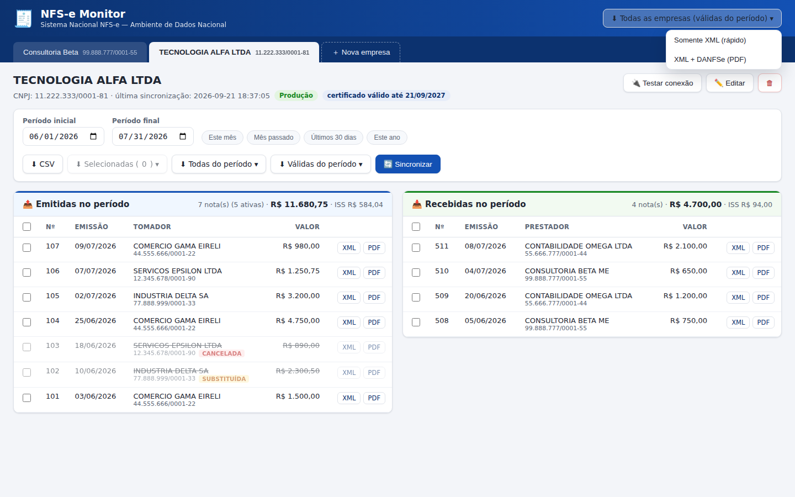

# NFS-e Monitor — Portal Nacional da NFS-e

Aplicação web **local** para consultar e baixar as Notas Fiscais de Serviço
eletrônicas (NFS-e) do **Sistema Nacional NFS-e** (Portal Nacional —
[gov.br/nfse](https://www.gov.br/nfse)), em **ambiente de produção**.

Cada empresa é uma **aba** com seu próprio certificado digital A1. Para o
período escolhido (data inicial → data final), o painel mostra duas colunas:

- 📤 **Emitidas no período** — notas em que a empresa é a prestadora;
- 📥 **Recebidas no período** — notas em que a empresa é a tomadora.



## Funcionalidades

- **Abas por empresa**, com cadastro via certificado digital **A1 (.pfx/.p12)** —
  CNPJ, razão social e validade são extraídos automaticamente do certificado;
- **Procuração eletrônica**: uma aba pode consultar outro CNPJ (ex.: cliente
  do escritório) usando o certificado de quem recebeu a procuração;
- **Sincronização com o ADN** (Ambiente de Dados Nacional) pela API oficial de
  Distribuição de DF-e aos contribuintes (`GET /contribuintes/DFe/{NSU}`),
  com autenticação mútua **mTLS** e controle incremental por **NSU**;
- **Filtro por período** (data de emissão) com atalhos: este mês, mês passado,
  últimos 30 dias, este ano;
- **Totais por coluna**: quantidade, valor dos serviços e ISS (somando apenas
  notas ativas);
- **Eventos**: cancelamentos e substituições são aplicados automaticamente à
  situação das notas (etiquetas *CANCELADA* / *SUBSTITUÍDA*), pelo código do
  evento — bloqueio, desbloqueio, solicitação de análise e indeferimento não
  cancelam a nota;
- **Downloads**: XML da NFS-e, **DANFSe v2.0 (PDF)** gerado no próprio
  computador a partir do XML, com marca d'água nas canceladas/substituídas, e
  exportação **CSV** do período (abre no Excel);
- **Download em lote (ZIP)**: marque notas nas caixas de seleção e use
  **⬇ Selecionadas**, baixe **⬇ Todas do período** ou apenas as
  **⬇ Válidas do período** (exclui canceladas e substituídas) — em todos,
  escolha *Somente XML* ou *XML + DANFSe (PDF)*. O ZIP vem organizado nas
  pastas `Emitidas/` e `Recebidas/`;
- **Download consolidado de todas as empresas**: o botão
  **⬇ Todas as empresas (válidas do período)**, no topo da tela, gera um
  único ZIP — **`NFSe Baixadas.zip`** — com **uma subpasta por CNPJ**,
  contendo apenas as notas válidas do período selecionado, mais um
  `RESUMO.txt` com a contagem por empresa;
- Alerta de **vencimento do certificado** (30 dias) e **teste de conexão** com
  diagnóstico completo (URL chamada, HTTP, TipoConsulta, erros do ADN) que pode
  ser copiado para o suporte;
- Tudo fica **no seu computador**: banco SQLite local, senha do certificado
  criptografada (chave local em `data/.chave_secreta`).

## Requisitos

- **Python 3.10 ou superior** — [python.org/downloads](https://www.python.org/downloads/)
  (no Windows, marque *"Add Python to PATH"* na instalação);
- Certificado digital **A1** (arquivo `.pfx` ou `.p12` + senha) de cada empresa,
  emitido por autoridade ICP-Brasil (e-CNPJ);
- Internet liberada para `adn.nfse.gov.br` (porta 443).

## Como executar

### Windows

Dê dois cliques em **`run.bat`** (na primeira execução ele cria o ambiente e
instala as dependências). O navegador abre automaticamente em
`http://127.0.0.1:8765`.

### Linux / macOS

```bash
./run.sh
```

### Manual (qualquer sistema)

```bash
pip install -r requirements.txt
python run.py            # abre o navegador em http://127.0.0.1:8765
python run.py --port 9000 --no-browser   # opções
```

## Como usar

1. **＋ Nova empresa** → selecione o arquivo `.pfx`, informe a senha e o
   ambiente (**Produção** para notas reais). O sistema valida o certificado e
   cria a aba da empresa. Deixe **CNPJ a consultar** em branco para as notas
   do próprio titular do certificado; preencha só para consultar outra empresa
   que deu procuração eletrônica a ele.
2. Clique em **🔌 Testar conexão** — mostra exatamente o que o ADN respondeu.
3. Clique em **🔄 Sincronizar**. A primeira sincronização baixa **todo o
   histórico** disponível no ADN para o CNPJ (em lotes de até 50 documentos);
   as seguintes baixam apenas o que for novo (controle por NSU).
4. Escolha o **período inicial e final** — as colunas de emitidas e recebidas
   e os totais são recalculados na hora (consulta local, instantânea).
5. Clique numa nota para ver os detalhes (valores, ISS, discriminação, chave
   de acesso, eventos) ou use os botões **XML** / **PDF** / **⬇ CSV**.
6. Para entregar tudo de uma vez à contabilidade, use
   **⬇ Todas as empresas (válidas do período)** no topo: um ZIP só, com uma
   pasta por CNPJ, já sem canceladas e substituídas. Sincronize cada empresa
   antes, para que o período esteja completo.

> **Frequência de sincronização:** o manual do ADN pede intervalo mínimo de
> **1 hora** entre consultas quando não há documentos novos. Sincronize uma ou
> duas vezes por dia — o filtro por período não precisa de nova sincronização.

## Como funciona (API oficial)

O sistema usa uma única rota, com **mTLS** (certificado ICP-Brasil):

```
GET https://adn.nfse.gov.br/contribuintes/DFe/{ultimoNSU}?lote=true&cnpjConsulta={CNPJ}
```

- `lote=true` devolve os documentos com NSU **maior** que o informado; o
  sistema lê lote após lote até o ADN responder que não há mais (HTTP 404 /
  `NENHUM_DOCUMENTO_LOCALIZADO`) — a resposta não informa o total;
- `cnpjConsulta` (ou `cpfConsulta`) é **obrigatório desde 03/11/2026**;
- o ADN distribui os documentos em que o CNPJ consultado figura como
  **emitente, tomador ou intermediário** — é isso que alimenta as colunas;
- o XML vem em GZip+Base64 no campo `ArquivoXml` e é interpretado pelo
  leiaute nacional (namespace `http://www.sped.fazenda.gov.br/nfse`).

**DANFSe:** a API nacional que devolvia o PDF (`GET /danfse/{chave}`) foi
**desligada em 03/08/2026** (NT 008/2026). O PDF é gerado localmente a partir
do XML, no leiaute DANFSe v2.0, pela biblioteca
[BrazilFiscalReport](https://github.com/Engenere/BrazilFiscalReport)
(LGPL-3.0). O documento com valor fiscal continua sendo o XML.

Documentação oficial: [APIs Prod. Restrita e Produção](https://www.gov.br/nfse/pt-br/biblioteca/documentacao-tecnica/apis-prod-restrita-e-producao) ·
[Manual do contribuinte — APIs do ADN](https://www.gov.br/nfse/pt-br/biblioteca/documentacao-tecnica/documentacao-atual/manual-contribuintes-apis-adn-sistema-nacional-nfse.pdf)

## Solução de problemas

Comece sempre pelo **🔌 Testar conexão**: ele mostra a URL chamada, o HTTP,
o `TipoConsulta`, o `StatusProcessamento` e os erros devolvidos pelo ADN, e
tem um botão para copiar o diagnóstico.

**`REJEICAO` com `TipoConsulta: InscricaoCertificado` e `Erros` vazio** — é a
resposta do ADN a uma consulta **sem** `cnpjConsulta` (exigido desde
03/11/2026). Confira no diagnóstico se a URL chamada contém
`cnpjConsulta=...`; se não contiver, atualize o sistema para a versão atual.

**`E2245` — "Não há procuração da inscrição X para a inscrição Y"** — o
certificado é de outro CNPJ (outra raiz) e não tem procuração eletrônica da
empresa consultada. A procuração precisa ter sido dada **exatamente à
inscrição do certificado** (e-CNPJ do escritório ou e-CPF do contador) e
incluir o serviço da NFS-e.

**`REJEICAO` com `TipoConsulta: CnpjBase` e `Erros` vazio** — o certificado é
da empresa, mas o ADN recusou sem dizer o motivo: confira se o CNPJ está
habilitado no Sistema Nacional NFS-e.

**HTTP 401 / 403 / 495 / 496, ou falha no "aperto de mão TLS"** — problema no
certificado: vencido, senha errada ou não é ICP-Brasil.

**"Não foi possível validar o certificado do servidor"** — antivírus/firewall
inspecionando HTTPS, ou cadeia da AC ausente (salve-a em `data/ca_extra.pem`).

**HTTP 429 ou 5xx** — ADN indisponível ou consultas frequentes demais. O
sistema tenta de novo sozinho; respeite o intervalo de 1 hora quando não
houver documentos novos.

**Sincronização conclui com "documento(s) não puderam ser lidos"** — o ADN
entregou XMLs que o sistema não conseguiu interpretar; a mensagem lista o NSU
de cada um. Envie essa mensagem ao suporte.

## Limitações importantes

- **Somente consulta/download** — o sistema não emite NFS-e;
- **Certificado A1** apenas (A3/token não é suportado);
- O ADN só contém notas de **municípios integrados ao padrão nacional** (ou
  que compartilham seus documentos com o ADN). Notas de sistemas municipais
  não conveniados não aparecem;
- A distribuição é sequencial por NSU: **não há filtro de data no servidor** —
  por isso o sistema sincroniza tudo uma vez e filtra localmente;
- O certificado precisa ser do **mesmo CNPJ** (ou mesma raiz de CNPJ) das
  notas consultadas, ou ter **procuração eletrônica** da empresa consultada.

## Segurança

- A pasta **`data/`** guarda certificados, senhas criptografadas e o banco de
  notas — ela está no `.gitignore` e **nunca deve ser copiada/enviada**;
- A senha de cada certificado é criptografada (Fernet/AES-128) com a chave
  local `data/.chave_secreta`;
- O servidor escuta apenas em `127.0.0.1` (não é acessível pela rede). Não
  exponha a porta na internet sem adicionar autenticação.

## Testes

```bash
python tests/e2e.py
```

Sobe um **ADN simulado com mTLS real** (certificados de teste gerados na hora)
que reproduz o comportamento observado em produção — rejeição sem
`cnpjConsulta`, `E2245` sem procuração, fim do feed com HTTP 404, resposta sem
total de NSU, lotes menores que 50 — e valida o fluxo completo: cadastro,
procuração, sincronização em vários lotes, eventos, filtro por período,
DANFSe local, ZIPs e idempotência.

## Variáveis de ambiente (avançado)

| Variável | Uso |
|---|---|
| `NFSE_DATA_DIR` | Pasta de dados (padrão: `./data`) |
| `NFSE_ADN_BASE` | Redireciona a API do ADN (testes) |
| `NFSE_CA_EXTRA` | PEM de CA adicional para o TLS do servidor nacional |

## Estrutura do projeto

```
app/            backend FastAPI
  main.py       rotas da API local
  adn_client.py cliente mTLS da distribuição do ADN (com diagnóstico)
  danfse.py     geração local do DANFSe v2.0 em PDF
  certificado.py leitura do .pfx e extração de CNPJ (ICP-Brasil)
  xml_nfse.py   parser do leiaute nacional (NFS-e e eventos)
  sync.py       sincronização incremental por NSU
  db.py         SQLite local
  security.py   criptografia das senhas
static/         interface web (abas, colunas, filtros)
tests/          ADN simulado + teste de ponta a ponta
run.py|bat|sh   inicialização
```
